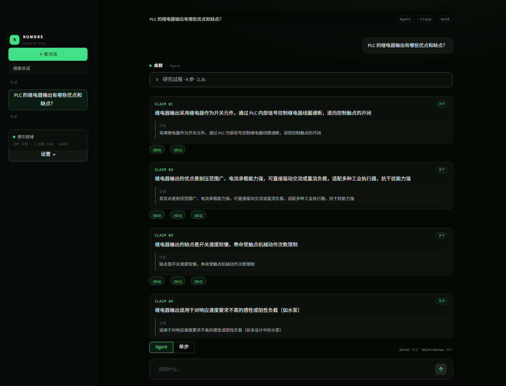
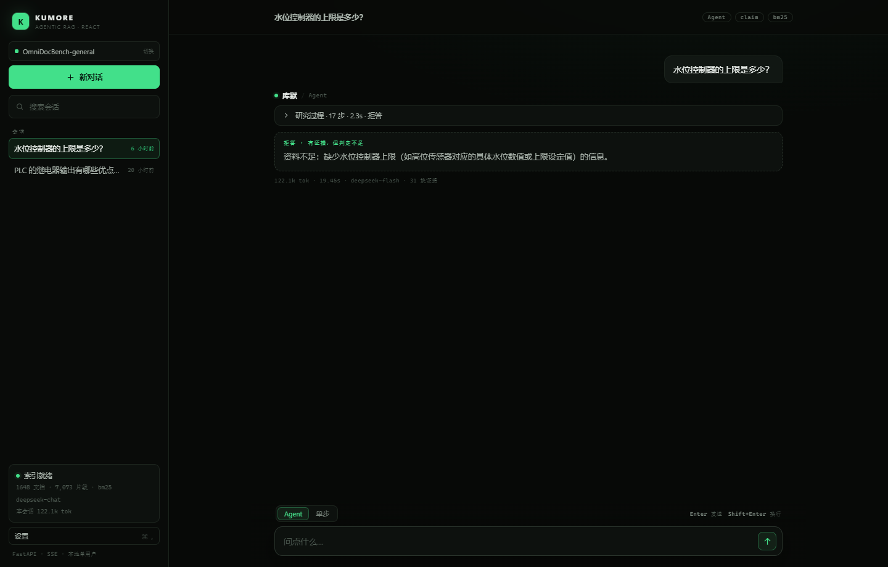
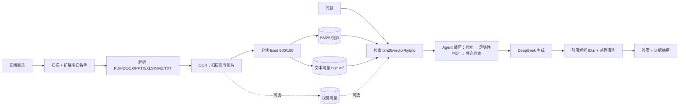

# 库默 Kumore · 便携版

<p align="center">
  <strong>你的课程资料、竞赛文档、项目报告，双击就能问。</strong><br/>
  每个答案带可回溯的引用；找不到证据，就回答「资料不足」。
</p>

<p align="center">
  
  <a href="#-实测数据"></a>
  <a href="LICENSE-KUMORE"></a>
  
</p>

<p align="center">
  <a href="#-快速开始">快速开始</a> ·
  <a href="#-第一次使用">第一次使用</a> ·
  <a href="#-配置">配置</a> ·
  <a href="#-实测数据">实测数据</a> ·
  <a href="#-常见问题">常见问题</a>
</p>

> **给谁**：自己的文档很多、又需要答案能被核对的人——学生、研究者、小团队。
> **解决什么**：通用聊天机器人不知道你的资料；把整库上传云端不放心；关键词搜索不懂同义改写；
> 而多数 RAG 工具在检索失败时会编一个像样的答案。
>
> 库默的立场是：**宁拒不编**。每个答案都带 `[ID:n]` 引用，点开能回到原文页码；
> 检索不到证据时，直接说「资料不足」。

---

<details open>
<summary><b>目录</b></summary>

- [库默是什么](#-库默是什么)
- [界面](#-界面)
- [快速开始](#-快速开始)
- [第一次使用](#-第一次使用)
- [配置](#-配置)
- [命令行与本地 API](#-命令行与本地-api)
- [实测数据](#-实测数据)
- [架构与隐私](#-架构与隐私)
- [常见问题](#-常见问题)
- [目录结构](#-目录结构)
- [License](#license)
- [致谢](#致谢)

</details>

---

## 💡 库默是什么？

库默（Kumore）是一个 **Windows 便携客户端**：目录里已经带好 Python 运行时、React 前端和本地模型，
不用安装 Docker、数据库或 Node。拿到完整便携包后，放到任意本地目录，双击 `Kumore.exe` 就能用。

把 PDF、Word、PowerPoint、Excel、Markdown、纯文本以及扫描件放进一个目录，它会：

1. **在本地建索引**：解析 → 分块 → BM25（可选本地向量）。
2. **回答时只发 top-k 片段**：出网的只有问题和检索到的正文，文件名与路径默认不发送。
3. **给每个结论配引用**：答案里的 `[ID:n]` 能逐条映射回原文的页码、小节和上下文。
4. **证据不足就拒答**：输出「资料不足：……」，而不是用先验知识补全。

**它不是**一个联网的知识库服务：没有账号、没有多租户、没有云端同步，后端只监听 `127.0.0.1`。
索引、原文和会话都留在这台电脑的 `backend\storage\` 里。

> 当前便携包版本 **v0.2**。完整目录约 **8 GB**，其中本地模型约 4.8 GB。
> 本仓库保留源码、前端、说明与截图；`Kumore.exe`、Python 运行时、模型和示例知识库体积较大，另行分发。

## 📸 界面



*一次真实问答：左侧是会话与索引状态，中间是「研究过程」和逐条 claim，每条 claim 下方挂着
`[ID:0]`、`[ID:1]` 这样的证据编号，点开是原文与页码。*



*同一设计的另一面：检索到了相关内容，但不足以回答「水位控制器的上限」，
于是输出「资料不足」并说明缺什么。这是产品行为，不是错误分支。*

## 🚀 快速开始

**前置条件**

| 项 | 要求 |
| --- | --- |
| 系统 | Windows 10 / 11，64 位（本机 Windows 11 实测） |
| 磁盘 | 完整目录约 8 GB；新建知识库的索引另算 |
| 内存 | 建议 8 GB 以上（本地模型常驻占用较大） |
| 网络 | 生成答案时访问 `api.deepseek.com`；解析、索引、检索都不联网 |

**五步跑起来**

1. 拿到完整便携包后，把整个 `库默Kumore` 目录放到本地磁盘（不要放只读目录或网盘同步目录）。
2. 双击 `Kumore.exe`。启动器会拉起本地 Python 后端，几秒后出现窗口；首次提问时语义模型可能仍在后台预热，此时会先走 BM25，界面上会显示就绪状态。
3. 在「设置」里填 DeepSeek API Key（也可以直接改 `backend\.env` 的 `DEEPSEEK_API_KEY`）。
4. 菜单「文件 → 打开知识库文件夹…」，选择你的文档目录；等待索引完成。
5. 在底部输入问题。回答里的 `[ID:n]` 可以点开看原文。关闭窗口即结束后端进程。

> 首次入库会做 OCR、分块和建索引。本机 183 份文档、1,655 个片段约 2 分钟；
> 文档更多或扫描页更多时会更久。进度与失败原因可以在下面「命令行与本地 API」的 `stats` 里看到。

## 🧭 第一次使用

**界面**

| 区域 | 用途 |
| --- | --- |
| 左栏 | 新建会话、历史会话、知识库切换、索引状态、设置入口 |
| 中间 | 提问、研究过程（可折叠）、claim 卡片、最终答案 |
| 证据编号 | 点开引用抽屉，显示原文片段、页码与小节 |
| 底部 | 输入框、Agent / 单步切换、发送与停止 |

**知识库**

- 新建：在知识库面板里输入名称并选择目录；也可以上传单个文件。
- 切换：左栏顶部；每个库有独立的语料、索引和代际，互不污染。
- 重建：语料变化后点「重建索引」；重建失败会保留上一代索引。
- 编辑：面板里可以改名、编辑文本文件、删除文件。

**会话**

会话自动保存在 `backend\storage\ui_sessions\`；支持归档、还原、删除。
关闭窗口不会丢会话。

**生成中**

界面支持 token 流式输出；点停止会中断本轮合成。研究轮的工具调用不能瞬间打断，
停止后不会把半截回答写进会话。

## ⚙️ 配置

配置集中在 `backend\.env`。改完重启 `Kumore.exe` 生效；日常更推荐用界面的设置面板。

| 变量 | 必填 | 默认 | 说明 |
| --- | --- | --- | --- |
| `KUMORE_CORPUS_ROOT` | 建议 | `./data/corpus` | 默认语料目录；新建知识库时可在界面另选 |
| `DEEPSEEK_API_KEY` | 生成时 | 空 | 只影响生成；检索和入库不需要 |
| `DEEPSEEK_BASE_URL` | 否 | `https://api.deepseek.com` | OpenAI 兼容端点 |
| `DEEPSEEK_MODEL` | 否 | `deepseek-chat` | 请求参数里的模型名 |
| `KUMORE_RETRIEVAL_MODE` | 否 | `bm25` | `bm25` / `vector` / `hybrid`；默认 bm25 |
| `KUMORE_TOP_K` | 否 | `5` | 每次检索返回的片段数 |
| `KUMORE_CHUNK_SIZE` / `KUMORE_CHUNK_OVERLAP` | 否 | `800` / `150` | 分块窗口字符数与重叠 |
| `KUMORE_OCR_MODE` | 否 | `auto` | `auto` 只补读文字层过少的页；`always` / `off` |
| `KUMORE_OCR_DPI` / `KUMORE_OCR_MAX_SIDE` | 否 | `150` / `1400` | 扫描页渲染精度与内存上限 |
| `KUMORE_SEND_PATHS` | 否 | `0` | 是否把标题与相对路径发给模型；默认不发 |
| `KUMORE_LLM_CACHE` | 否 | `0` | 响应缓存：重复提问逐字一致，也省钱 |
| `KUMORE_RERANK` | 否 | `0` | 本地重排；默认关闭（CPU 上较慢） |
| `KUMORE_MAX_FILE_MB` | 否 | `300` | 只用来挡超大文件 |

## 🧪 命令行与本地 API

日常用界面就够了。需要批量或脚本化时，用目录里自带的 Python 运行时：

```powershell
cd backend

# 索引状态、失败清单
.venv\Scripts\python.exe -m app stats

# 只检索，不调用模型
.venv\Scripts\python.exe -m app search "PLC 的继电器输出有什么特点"

# 生成带引用的回答
.venv\Scripts\python.exe -m app ask "PLC 的继电器输出有哪些优点和缺点？"

# 知识库
.venv\Scripts\python.exe -m app kb list
```

也可以只启动本地 API，在浏览器里访问（先关掉 `Kumore.exe`，避免两个后端同时写索引）：

```powershell
cd backend
.venv\Scripts\python.exe -m app web --port 8000
# http://127.0.0.1:8000 ；接口文档 /docs
```

| 端点 | 作用 |
| --- | --- |
| `POST /api/ask` | 同步一问一答 |
| `POST /api/ask/stream` | SSE：研究步骤、token 流、最终答案 |
| `GET /api/chunks/{chunk_id}` | 引用原文与页码 |
| `GET /api/kbs` | 知识库列表 |
| `GET /api/health` | 索引与语义模型是否就绪 |

## 📊 实测数据

测试集：45 题、1,655 个片段（2026-10）。

| 维度 | 结果 | 口径 |
| --- | --- | --- |
| 检索 Hit@5（bm25） | **0.9231** | 45 题、1,655 片段、离线 |
| 检索 Hit@5（hybrid-rrf） | 0.8205 | 同批；RRF 相对 bm25 是 0 题挽回 / 4 题丢失 |
| Agent 可答率 | **39/39** | 45 题、6 次中位数 |
| 引用精确率 | 0.6749 | 同批；单步模式 0.6885，差 −1.4 pt，在批间极差 4.2 pt 内 |
| claim 逐字率 | **95.5%** | 126 条 claim、3 次中位数 |
| 无答案拒答 | 6/6 | 拒答测试；越界引用 0 |
| 自动测试 | **410 passed** | `pytest`，2026-10-31 |

## 🧠 架构与隐私



*默认链路是实线：BM25 检索。是否走 Agent 循环由 `mode` 决定——界面默认 `agent`，
命令行的 `ask` 是单步、`agent` 才走循环。视觉索引只覆盖 PDF 的 OCR 页与独立图片。*

### 数据流向（会联网吗）

只有生成答案会联网：

| 步骤 | 是否联网 | 离开本机的内容 |
| --- | --- | --- |
| 解析 / 分块 / 建索引 | **否** | 无 |
| 本地向量化 | **否** | 无 |
| 检索（BM25 / 向量 / 混合） | **否** | 无 |
| 生成答案（`ask` / 界面问答） | **是**（`api.deepseek.com`） | 问题原文 + ≤5 条主结果 + ≤2 条版本补充（每条 ≤800 字）+ 页码 / 小节 / 版本标签 + 系统提示 |

明确**不发送**：原始文件、索引数据库、会话记录、文件名、相对路径。
`KUMORE_SEND_PATHS=1` 可以打开路径调试，默认关闭。

### 隐私边界

- 文件名与路径默认不发送；模型只需要 `[ID:n]` 就能引用，回填真实路径在本地完成。

## 🩺 常见问题

| 现象 | 原因 | 处理 |
| --- | --- | --- |
| 双击 `Kumore.exe` 没反应 / 白屏 | 后端没起来，或目录不完整 | 看 `%APPDATA%\Kumore\logs\desktop.log`；确认 `backend\.venv\Scripts\python.exe` 存在 |
| 换电脑后启动失败 | `.venv` 的 base Python 指向原机器 | 装同版本 Python 3.12 后重建 `backend\.venv`，步骤见 `使用说明.txt` |
| 提示 API 错误 / 401 / 余额不足 | Key 无效、过期或欠费 | 在「设置」里重填 Key；或改 `backend\.env` 后重启 |
| 第一次提问等很久 | 本地模型冷加载（约 10–20 秒） | 等预热完成；界面上会显示语义模型是否就绪 |
| 扫描件问不出内容 | PDF 没有文字层 | 默认 `auto` 会自动 OCR；仍不行时试 `KUMORE_OCR_MODE=always` |
| `.doc` 文件没进库 | 旧 OLE 格式需要 LibreOffice | 先用 LibreOffice 批量转成 `.docx` 再入库 |
| 移动目录后知识库空了 | `kb.json` 里记的是绝对路径 | 重新「打开知识库文件夹」或重建索引 |
| 索引要多久 | 取决于文档数与 OCR 页数 | 183 份约 2 分钟；首次可先用小目录试 |
| 关窗口后任务管理器还有 python | 极少数情况下后端进程残留 | 手动结束；或重启电脑后再启动 |
| 想换端口 / 浏览器访问 | 桌面端用随机端口 | 关掉 exe 后 `cd backend` 再跑 `.venv\Scripts\python.exe -m app web --port 8000` |
| 磁盘占用越来越大 | 每个知识库保留独立索引（模型缓存共享） | 在知识库面板删除不用的库；`storage\kbs` 可手动清理 |
| 中文显示乱码 | 终端编码不是 UTF-8 | 在 PowerShell 里先设 UTF-8；数据本身通常没坏 |

## 📁 目录结构

完整便携包（含运行时与模型）的目录如下；仓库只保留源码、前端、说明与截图。

```text
库默Kumore\
├── Kumore.exe                  # 双击启动
├── *.dll / *.pak / locales\    # Electron 壳（不要删）
├── resources\app\              # 窗口与启动逻辑（main.js / preload.js）
├── backend\
│   ├── app\                    # Python 后端
│   ├── web\dist\               # React 前端构建产物
│   ├── .venv\                  # 自带 Python 3.12 运行时（不要删）
│   ├── .env                    # 检索 / 模型配置 + API Key
│   └── storage\
│       ├── kbs\                # 知识库注册表与各代索引
│       ├── models\             # 本地模型（文本塔 / 视觉塔）
│       ├── corpora\            # 知识库引用的语料副本
│       └── ui_sessions\        # 历史会话
├── images\                     # 本 README 的截图
├── README.md
├── 使用说明.txt                # 打包细节与换机说明
├── LICENSE                     # Electron 的许可证
└── LICENSE-KUMORE              # 库默本体的 MIT 许可证
```

## License

库默本体以 **MIT** 协议发布，见 [`LICENSE-KUMORE`](LICENSE-KUMORE)。

本目录根部的 `LICENSE` 与 `LICENSES.chromium.html` 属于 Electron / Chromium，随 Electron 运行时一起分发。
第三方依赖（pdfminer.six、python-docx、python-pptx、openpyxl、RapidOCR、ONNX Runtime、
FastAPI、Streamlit、React 等）各自遵循其许可证。

## 致谢

- [RAGFlow](https://github.com/infiniflow/ragflow)：检索、引用与 agent 循环的机制参照。
- [BAAI BGE](https://github.com/FlagOpen/FlagEmbedding)：`bge-m3`、`bge-visualized-m3`、`bge-reranker-base`。
- [RapidOCR](https://github.com/RapidAI/RapidOCR) 与 ONNX Runtime：扫描件 OCR，纯 CPU、无需外部程序。
- PDFium（`pypdfium2`）、pdfminer.six、python-docx、python-pptx、openpyxl：文档解析。
- [DeepSeek](https://www.deepseek.com/)：生成侧 API。
- FastAPI、Streamlit、React、Vite、Electron：界面与服务层。
